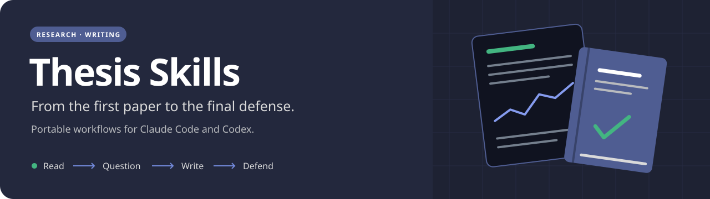

<p align="center">
  
</p>

<p align="center">
  <a href="docs/installation.md"></a>
  <a href="docs/installation.md#claude-code-plugin"></a>
  <a href="docs/skills.md"></a>
  <a href="https://github.com/hashimkarim/thesis-skills/actions/workflows/validate.yml"></a>
  <a href="LICENSE"></a>
</p>

<p align="center">
  <strong>Clear arguments. Traceable evidence. Your own voice.</strong><br>
  Seven portable skills for Claude Code and Codex, built around the work of writing a thesis.
</p>

<p align="center">
  <a href="#install">Install</a> · <a href="docs/skills.md">Skill guide</a> · <a href="docs/project-setup.md">Adapt to your project</a> · <a href="docs/pdf-conversion.md">PDF conversion</a> · <a href="docs/provenance.md">Origins</a>
</p>

## What you get

Turn papers into searchable Markdown, develop a research argument, check claims,
revise chapters, work in LaTeX, and prepare your defense. The skills preserve the
author's meaning and distinguish what the evidence shows from what is proposed.

| Skill | Helps with |
| --- | --- |
| [thesis-writing](skills/thesis-writing/SKILL.md) | Storylines, concept order, accessible explanations, abstracts, chapters, captions |
| [convert-pdfs-to-markdown](skills/convert-pdfs-to-markdown/SKILL.md) | Local Marker conversion, extracted images, source mapping, extraction QA |
| [thesis-literature-review](skills/thesis-literature-review/SKILL.md) | Searches, reading notes, comparison matrices, related-work synthesis |
| [thesis-research](skills/thesis-research/SKILL.md) | Research questions, study design, fair comparisons, limitations |
| [thesis-citations](skills/thesis-citations/SKILL.md) | Claim support, source passages, bibliography metadata, attribution |
| [thesis-latex](skills/thesis-latex/SKILL.md) | Existing templates, builds, figures, tables, cross-references |
| [thesis-presentation](skills/thesis-presentation/SKILL.md) | Defense structure, slide content, visual briefs, rehearsal and Q&A |

Each folder is a complete skill shared by both assistants. There is no required
university, research topic, folder layout, account integration, or conda environment.
Your project supplies the context; the skills supply reusable workflows.

## Install

**Both assistants, with Python 3.10+ and Git:**

```bash
git clone https://github.com/hashimkarim/thesis-skills.git
cd thesis-skills
python3 install.py --agent both
```

On Windows, use `py -3` in place of `python3`. You can also
[download the ZIP](https://github.com/hashimkarim/thesis-skills/archive/refs/heads/main.zip),
extract it, and run the same installer inside the extracted folder.

The installer copies skills into `~/.agents/skills` for Codex and
`~/.claude/skills` for Claude Code. Restart your session if they do not appear.
It uses only Python's standard library and downloads nothing. Existing or edited
skills are protected; `--force` makes backups before replacing them.

**Claude Code plugin, without cloning manually:**

```bash
claude plugin marketplace add hashimkarim/thesis-skills
claude plugin install thesis-skills@thesis-skills
```

Choose either the plugin or the Python installer for Claude to avoid duplicate
skill entries. For Codex only, use `python3 install.py --agent codex`.

See [installation](docs/installation.md) for project-local installs, individual
skills, custom locations, updates, backups, and removal.

## Make it yours

Create a brief in an **existing** thesis project, then customize its audience,
language, paths, sources, and build commands:

```bash
python3 scripts/init_project.py "../my-thesis"
```

The resulting [`THESIS.md`](examples/THESIS.md) is plain Markdown. Paths are
relative to that file, so the brief can move with your project. Existing briefs
are never overwritten. The skills also work with your established project
instructions when you do not want another configuration file.

For a team, install copies directly into the thesis repository:

```bash
python3 install.py --agent both --project "../my-thesis"
```

Commit the installed `.agents/skills/` and `.claude/skills/` folders with the
shareable parts of your brief. Collaborators receive the same workflows when
they clone your project. See [project setup](docs/project-setup.md).

## Start a conversation

In Codex:

```text
Use $thesis-writing to review my introduction against THESIS.md.
Propose a clearer storyline before changing the manuscript.
```

In Claude Code with copied skills:

```text
/thesis-writing Review my introduction against THESIS.md and propose a clearer storyline.
```

With the Claude plugin, use `/thesis-skills:thesis-writing`. The other skills
follow the same naming pattern. [More example prompts →](docs/skills.md)

## PDF conversion is optional

Writing and research guidance do not need model downloads or GPU hardware.
Conversion additionally needs [uv](https://docs.astral.sh/uv/getting-started/installation/)
and downloads the pinned Marker package and its model weights on first use.

From this checkout:

```bash
python3 skills/convert-pdfs-to-markdown/scripts/convert.py "../my-thesis/literature/pdfs" --output-dir "../my-thesis/literature/markdown" --dry-run
```

Remove `--dry-run` to convert. Add `--require-gpu` to require CUDA; otherwise CPU
execution is permitted. Outputs include Markdown, relative image links, and a
source checksum record. Conversion quality still needs representative page
checks. [Setup, options, and troubleshooting →](docs/pdf-conversion.md)

## Maintain and contribute

```bash
python3 scripts/validate.py
python3 -m unittest discover -s tests -v
```

CI runs portable validation and behavioral tests on Linux, macOS, and Windows.
It does not download OCR models. Follow [CONTRIBUTING.md](CONTRIBUTING.md) when
adding guidance or changing scripts; the [validation guide](docs/validation.md)
explains the checks and their limits.

Adapted from a real thesis-writing workflow, with project-specific details
removed and focused companion skills added. See [provenance](docs/provenance.md).
The package is [MIT licensed](LICENSE); external software and model weights keep
their own terms. Original papers, private feedback, and third-party assistant
skills are not bundled.

<p align="center"><sub>Badges by <a href="https://shieldcn.dev">shieldcn</a> · Banner colors from <a href="https://github.com/hashimkarim/comfy-themes">Comfy</a></sub></p>
